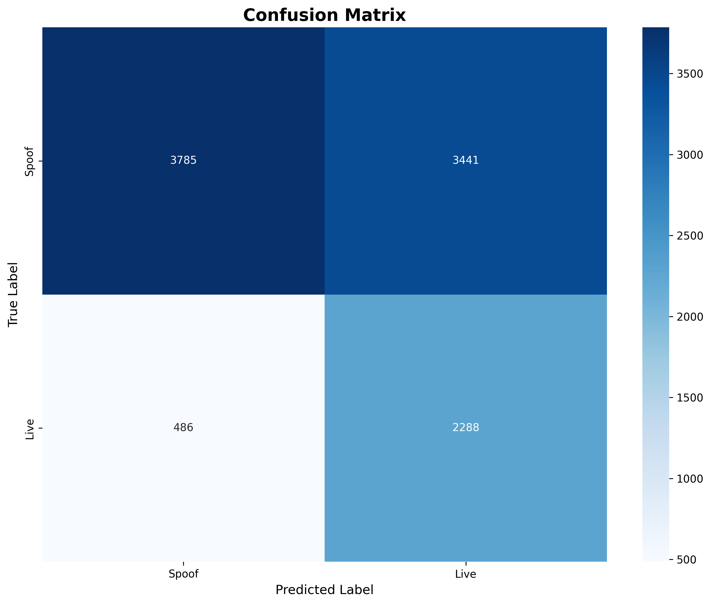
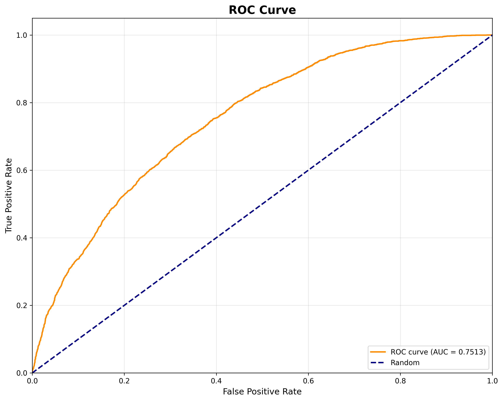
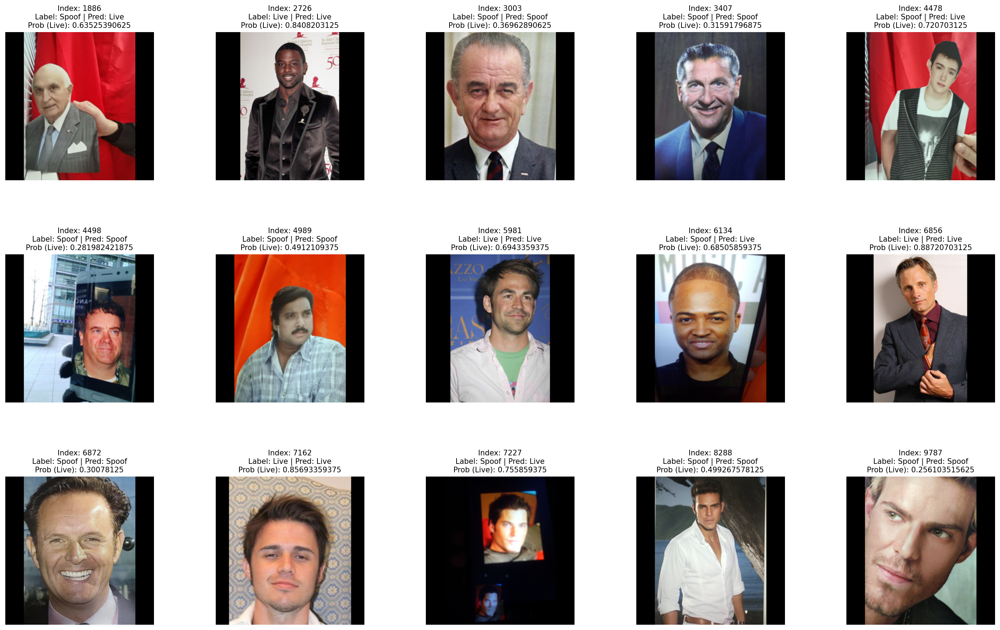

# ViT Face Anti-Spoofing

A face anti-spoofing classification model built with **Vision Transformer (ViT)** and PyTorch to distinguish live faces from spoof attacks. The model uses a pretrained ViT backbone with a custom MLP classifier for binary classification.

## Model

The model consists of a ViT feature extractor and a classification head.

- **Backbone:** Vision Transformer (ViT), implemented using `timm`
- **Input image size:** 224 × 224 pixels
- **Feature normalization:** LayerNorm
- **Classifier:** Linear → GELU → Linear
- **Regularization:** Dropout
- **Output classes:** Live and Spoof
- **Framework:** PyTorch

### Architecture

```python
class ViTFaceAntiSpoofing(nn.Module):
    def __init__(self):
        super().__init__()
        self.vit = timm.create_model(
            model_name,
            pretrained=pretrained,
            num_classes=0
        )
        embed_dim = (
            self.vit.num_features
            if hasattr(self.vit, "num_features")
            else 768
        )

        self.classifier = nn.Sequential(
            nn.LayerNorm(embed_dim),
            nn.Dropout(dropout),
            nn.Linear(embed_dim, 512),
            nn.GELU(),
            nn.Dropout(dropout),
            nn.Linear(512, num_classes)
        )

    def forward(self, x):
        features = self.vit(x)
        return self.classifier(features)
```

The ViT backbone extracts visual features from each input image. The classification head transforms these features into two output logits corresponding to the Live and Spoof classes.

## Dataset

The model is trained and evaluated using the [Ar4ikov/celebA_spoof](https://huggingface.co/datasets/Ar4ikov/celebA_spoof) dataset from Hugging Face.

```python
from datasets import load_dataset

ds = load_dataset("Ar4ikov/celebA_spoof")
```

### Dataset split

| Split | Available samples | Used samples |
|---|---:|---:|
| Train | 419,935 | 419,935 |
| Test | 59,191 | 10,000 |

The training process uses the complete training split. For evaluation, 10,000 samples are randomly selected from the available test split of 59,191 samples.

### Preprocessing

- Resize input images to 224 × 224 pixels.
- Apply the image preprocessing required by the ViT backbone.
- Convert images into tensors for PyTorch inference.

## Model Weights

The trained model checkpoint is available on Google Drive.

**[Download model.pth](https://drive.google.com/file/d/1s2r48x8lm3i5ui3jdk5YXFmpjKlvhq64/view?usp=sharing)**

Download the checkpoint and place it in your project directory before loading the model. The model architecture and configuration used during training must match those used when loading the checkpoint.

## Evaluation Results

The model was evaluated on 10,000 randomly selected test samples.

### Overall metrics

| Metric | Score |
|---|---:|
| Accuracy | 0.6073 |
| Precision (PPV) | 0.3994 |
| Recall | 0.8248 |
| F1-score | 0.5382 |
| ROC-AUC | 0.7513 |
| Specificity | 0.5238 |
| Negative Predictive Value (NPV) | 0.8862 |
| False Acceptance Rate (FAR) | 0.4762 |
| False Rejection Rate (FRR) | 0.1752 |
| Equal Error Rate (EER) | 0.3219 |

### Confusion matrix

| Actual / Predicted | Live | Spoof |
|---|---:|---:|
| Live | 2,288 (TP) | 486 (FN) |
| Spoof | 3,441 (FP) | 3,785 (TN) |

The model correctly classified 6,073 out of 10,000 test samples, achieving 60.73% accuracy. Its recall of 82.48% indicates that it identifies a large proportion of positive-class samples, while its specificity of 52.38% indicates room for improvement in rejecting negative-class samples.

The ROC-AUC score of 0.7513 suggests that the model has discriminatory ability beyond random classification, although its classification threshold and false acceptance rate require further investigation before practical deployment.

*Note: The interpretation of positive and negative classes depends on the label mapping used during evaluation.*

### Test set distribution

| Class | Samples | Percentage |
|---|---:|---:|
| Live | 2,774 | 27.74% |
| Spoof | 7,226 | 72.26% |
| **Total** | **10,000** | **100%** |

The test set is imbalanced, with spoof samples accounting for 72.26% of the selected evaluation data. Accuracy should therefore be interpreted alongside precision, recall, specificity, and ROC-AUC.

## Visualizations

The `test_results/` directory contains the evaluation plots and example predictions.

```text
test_results/
├── confusion_matrix.png
├── roc_curve.png
└── example.png
```

### Confusion Matrix



The confusion matrix illustrates the distribution of correct and incorrect predictions for the Live and Spoof classes.

### ROC Curve



The ROC curve illustrates the trade-off between the true positive rate and false positive rate at different classification thresholds.

### Example Predictions



The example predictions visualize selected test images alongside their ground-truth labels, predicted labels, dataset indices, and model output probabilities. These examples help inspect the model's classification behavior on individual images.

## Limitations

- Evaluation uses a random subset of 10,000 samples rather than the complete test split.
- The reported metrics depend on the selected samples, label mapping, and classification threshold.
- The elevated false acceptance rate indicates that additional validation and threshold calibration are needed for security-sensitive face verification systems.
- Performance on other datasets, unseen spoof attacks, different capture devices, and real-world conditions has not been established by these results.

## Future Improvements

- Evaluate on the complete test split and additional face anti-spoofing benchmarks.
- Investigate class imbalance and optimize the classification threshold.
- Analyze false-positive and false-negative examples.
- Evaluate generalization across different spoof attack types and capture conditions.
- Optimize inference latency and memory usage for deployment.


